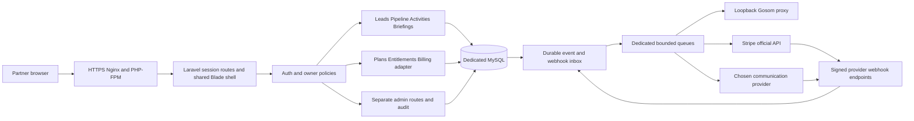

# Proposed system architecture

Everything in this chapter is a target design unless linked as existing evidence in [chapter 01](01-current-state.md).

## Boundaries and ownership

One Laravel 12 application, one dedicated MySQL 8.4 database, one authenticated personal workspace per User. Use user_id as the ownership key. Admin is a platform role, never a subscription tier. A partner upgrading to Pro gains no administrative rights.

Keep a single deployable codebase. Organize focused actions/services by module when complexity warrants them, without creating generic repositories, base tenant models or abstract event frameworks ahead of need. Controllers validate and authorize; actions own atomic transitions; Eloquent models express relationships; Jobs carry IDs and re-check authorization/resource state at execution; adapters own external contracts.

No shared sessions, keys, DB users, directories, communication instances or workflows with the internal Kaizen CRM.

Provider nodes, billing, domain-event outbox, extra queues and modules are proposed. Existing database jobs queue and Gosom adapter are real.

## Layer contracts

| Layer | Proposed location | Contract |
| --- | --- | --- |
| Routes/HTTP | routes/web.php, routes/api.php, app/Http/Controllers | HTML or versioned JSON; session/CSRF for browser; provider webhooks separately signed |
| Authorization | middleware, existing/new Policies, scoped queries | Role + active + verified + same owner; plan checks separate; no blanket admin bypass for partner records |
| Atomic use cases | app/Actions/{module} only when needed | Lock in consistent order, validate owned related IDs, commit data and outbox together |
| Queries | Eloquent scopes / narrowly scoped query objects | Server pagination, bounded aggregates; explicit admin aggregates |
| External integration | app/Services/{provider} or adapter contracts | Authenticated server requests, time budgets, idempotency keys, uncertainty classification |
| Background | Jobs and existing console scheduler | ID payloads, fresh state, outbox acknowledgement, no cross-user execution |
| Presentation | shared Blade layout/components + module CSS/JS | One shell, Inter/tokens; legacy adapters retain map/results behavior |
| Audit | admin_audit_logs plus domain histories where justified | Append-only actor/target/result/correlation with allowlisted changes; no secrets or full payload logs |

A full CQRS or DDD framework is unnecessary. Tests may call the same action classes as HTTP/jobs; copying their SQL into test helpers does not validate those paths.

## Key flows and state boundaries

**Identity:** explicit signup gate -> partner validation -> verification-capable limited session -> signed verification -> active/verified dashboard. B01 must repair the current unverified-login loop before signup is opened. Password reset remains Laravel broker based.

**Prospecting:** validate bounded request -> reserve physical scraper capacity transactionally -> persist submission intent -> one external POST -> persist ID -> status-only polls -> download terminal CSV outside DB locks -> fenced chunk/row import -> finalization + capacity release in one transaction. Ambiguous POST never auto-resubmits; hard timeout never proves remote cancellation. Business quota reservation is independent from physical scraper capacity.

**Lead to opportunity:** one owner-scoped Lead can have one current PipelineOpportunity under today's UNIQUE(user_id, lead_id). A future multi-deal business model requires an explicit new decision; do not silently remove this rule. Stage order defines the default destination. Lock a per-user coordination row (existing users row is sufficient) for stage topology changes, then stages by id, then opportunities by id; all writers must follow the same protocol.

**Payment:** choose configured plan -> pending Checkout intent -> Stripe-hosted Checkout -> signed durable event receipt -> current subscription synchronization -> access resolver. Browser success pages display pending/confirmed state; they do not grant paid entitlements. Free assignment never creates a paid Checkout.

**Domain effects:** commit entity mutation and event outbox record together; after-commit dispatch helps latency but an outbox drain repairs dispatch crashes. Consumers deduplicate by stable event+action key. External calls happen after DB locks are released. Avoid claims of exactly-once delivery: use at-least-once transport plus idempotent effects and explicit ambiguous states.

**Communication:** select an owned verified account/contact -> verify purpose/channel permission, provider state, quota and opt-out -> reserve action -> dispatch -> reconcile provider event. A publicly scraped contact is not an opt-in.

## Events, queues and scheduler

Proposed domain events: LeadCreated, OpportunityStageChanged, ActivityDue, CalendarEventScheduled, MessageReceived, CampaignFinished. Include event_id, owner_user_id, type/version, aggregate_id, occurred_at and minimal safe context. Resolve PII inside authorized handlers rather than distributing raw lead/message snapshots everywhere.

Keep database queues initially. Separate logical queue names for scraper, billing, notifications and campaigns as introduced. Add workers only with dedicated authorization and measured CPU/RAM; priority must prevent a slow scraper from starving billing webhooks. A single scheduler installation triggers outbox drain, reconciliation and reminders with overlap locks; never run both cron schedule:run and a separate schedule:work loop.

## Cross-cutting invariants

- Every related entity belongs to the same user unless the explicit resource is platform-wide.
- Suspension blocks new user-initiated effects. Platform-authorized status-only reconciliation/terminal cleanup of previously accepted external work must continue without new POST or data disclosure, so blocked accounts do not strand capacity.
- No destructive action is authorized by frontend visibility or plan label.
- No HTTP call under long-held database locks.
- External success, local commit and webhook delivery are not one transaction; persist intent and reconcile.
- No subscription cancellation erases Leads, opportunities or briefings.
- Database transactions protect local writes; MySQL DDL is not a general rollback boundary.
- Provider credentials stay private/encrypted; logs carry IDs and outcomes.
- Missing commercial configuration prevents the affected commercial action, not an invented paid/free policy.
- Product metrics use stored facts and documented definitions; unknown values remain unavailable.

## Extension criteria

Teams/organizations only after approved collaboration requirements and an explicit ownership migration. Redis only after database queue/lock pressure is measured. WebSockets only after polling is insufficient and an isolated real-time service is approved. Extract providers or workers to separate hosts before considering microservices when resource isolation requires it.
