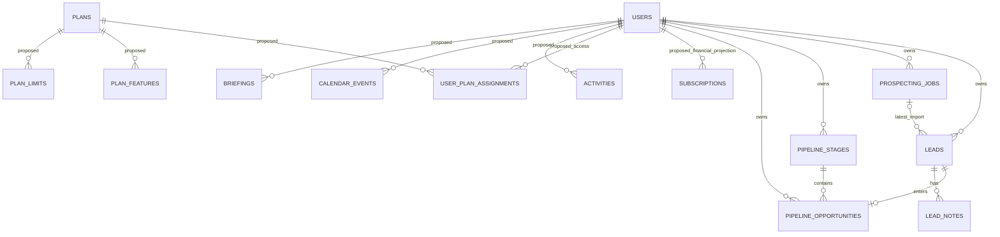

# Logical data model

Status: architecture proposal, based on a read-only source audit on 2026-10-20. No schema or database was inspected live or changed for this document. Existing means a migration/model exists in this workspace, not that a production migration has been verified.

## Scope and conventions

Keep the current single-account ownership model: `users.id` owns private CRM data through `user_id`. There is no organization/team membership in the current product. Do not add tenant databases, organization IDs, or collaborative assignment until a concrete business requirement justifies them.

The proposed types below use Laravel/MySQL logical notation: `id/FK` is an unsigned BIGINT, `uuid` is a UUID-compatible string, `string(n)` is VARCHAR, `text` is TEXT, timestamps are UTC timestamps, and JSON stores bounded provider metadata or versioned definitions. JSON must not replace relational ownership, identity, or state fields. Use application validation and MySQL constraints together. Future migrations must be tested against MySQL 8.4, independently of SQLite.

All private relationships must validate the same owner on both sides. An ordinary foreign key from `pipeline_opportunities.lead_id` to `leads.id` proves existence, not equal `user_id`. Existing controllers enforce ownership on public write paths; workers, commands, imports, and future services must enforce the same invariant. Composite constraints may be added in a later hardening migration where they materially protect cross-owner relationships. They are proposed, not currently present.

Do not create all candidate tables at once. Implement only the phase-authorized entities. No pricing, quotas, plan-feature mapping, provider selection, retention period, or grace period is approved by this model.

## Existing entities and exact source of truth

| Entity | Essential existing fields/types | Ownership and relationships | Existing keys/indexes | Delete and audit behavior |
| --- | --- | --- | --- | --- |
| `users` | `id`, `name:string`, `email:string`, `password:string`, `role:string`, `status:string`, nullable `email_verified_at`, `last_login_at`, `remember_token`, timestamps | Account identity; roles currently `partner`/`admin`, statuses `active`/`blocked` in validated admin forms | PK id; UNIQUE email; role/status indexes | Hard delete is possible at model level; no SoftDeletes. Numerous child cascades mean account deletion requires a separate approved retention design. Admin changes partly audited. |
| `password_reset_tokens` | `email:string`, `token:string`, nullable created timestamp | Authentication infrastructure, email reference without FK | PK email | Expire/revoke through Laravel reset flow. Never expose token. |
| `sessions` | `id:string`, nullable `user_id`, `ip_address:string(45)`, user agent text, payload longtext, last activity integer | Authentication sessions; `user_id` is indexed but has no FK in migration | PK id; user_id/last_activity indexes | Technical lifecycle only; sensitive payload/IP metadata must not enter audit logs. |
| `cache` | key string, value mediumtext, expiration integer | Application-wide technical infrastructure, namespaced keys | PK key | Expiration; never use as durable business truth. |
| `cache_locks` | key string, owner string, expiration integer | Technical distributed locks | PK key | Expiring coordination, not authorization. |
| `jobs` | id, queue string, payload longtext, attempts tinyint, nullable reserved timestamp integer, available/created integer | Technical queue records; business `user_id` resides in associated model, not this table | PK id; queue index | Queue lifecycle; safe payload handling and failed-job retention needed. |
| `job_batches` | id string, name, total/pending/failed integer counts, failed IDs longtext, options mediumtext, lifecycle integer timestamps | Laravel infrastructure | PK id | No application batch workflow found; retain framework table rather than inventing a feature. |
| `failed_jobs` | id, uuid string, connection/queue text, payload/exception longtext, failed timestamp | Technical failure diagnostics | PK id; UNIQUE uuid | Exceptions can contain sensitive metadata; restrict access/retention. |
| `scraper_capacity` | singleton tinyint id, unsigned capacity/used integers, timestamps | Platform-global scraper capacity, intentionally not user-owned | PK id; initial row id=1 inserted by migration | Preserve across jobs. No user-facing delete; changes need operational audit. |
| `prospecting_jobs` | id, user_id, nullable indexed scraper external ID; keywords JSON; nullable location; lat/lon DECIMAL(10,7); search parameters JSON; status string; progress unsigned int; slot bool; claimed/cancel/start/finish timestamps; nullable error text; deleted_at; timestamps | User-owned; belongs to user; has many leads; soft deletes | PK; user FK cascade; external ID/status/slot/claimed indexes; incremental UUID claim-token index | Soft deletion hides record, but is not equivalent to confirmed external cancellation. Never release capacity only because record was deleted. |
| `leads` | id, user_id, nullable prospecting_job_id; name/phone/email/category/source strings; website/address text; lat/lon DECIMAL(10,7); nullable external_place_id string; raw_data JSON; timestamps | User-owned business/company lead; optional last associated search | User FK cascade; job FK SET NULL; UNIQUE(user_id, external_place_id) | Hard deletion cascades notes and pipeline opportunity. Add explicit confirmation/retention decisions before exposing broad deletion UX. Nullable external IDs permit multiple NULLs in MySQL. |
| `lead_notes` | id, user_id, lead_id, content text, timestamps | User-owned note for owned lead | FKs user/lead cascade; index(user_id, lead_id) | Cascades with lead/account; no edit history exists. |
| `prospecting_exports` | id, user_id, nullable prospecting_job_id, format string, timestamps | User-owned export access record | User FK cascade; job FK SET NULL | Records export creation, not a durable file or complete download audit. |
| `admin_audit_logs` | id, admin_user_id, action string, nullable target_type/target_id, metadata JSON, created timestamp | Platform audit actor; target reference is polymorphic metadata without FK | Admin FK RESTRICT; index(target_type, target_id) | Preserve audit; RESTRICT can block deleting an admin actor. No secret before/after values. |
| `pipeline_stages` | id, user_id, name string, unsigned position int default 0, timestamps | User-owned ordered stages | User FK cascade; UNIQUE(user_id, name); no unique position constraint | Current stage delete cascades opportunities at FK level. Controller must transfer/check atomically before delete; see risks below. |
| `pipeline_opportunities` | id, user_id, lead_id, pipeline_stage_id, timestamps | User-owned one opportunity per lead; belongs to current stage | User, lead, stage FKs cascade; UNIQUE(user_id, lead_id) | Current cascade from stage can destroy opportunities if delete validation races. No won/lost/value/history fields exist. |
| `migrations` | migration identifier and batch maintained by Laravel | Technical migration history | Framework-managed | Do not edit manually; code rollback does not reverse schema/data. |

Sources: [`create_users_table`](../../database/migrations/0001_01_01_000000_create_users_table.php), [`create_cache_table`](../../database/migrations/0001_01_01_000001_create_cache_table.php), [`create_jobs_table`](../../database/migrations/0001_01_01_000002_create_jobs_table.php), [`create_prospecting_tables`](../../database/migrations/2026_10_19_000001_create_prospecting_tables.php), [`add_polling_claim_token`](../../database/migrations/2026_10_20_000002_add_polling_claim_token.php), [`create_pipeline_tables`](../../database/migrations/2026_10_20_000003_create_pipeline_tables.php).

## Existing integrity/concurrency gaps

These are source findings, not newly reproduced database incidents:

1. `PipelineController::destroyStage()` counts opportunities and loads the destination before entering its transaction. It does not lock/recheck the source and destination inside the transaction. An opportunity inserted/moved into a stage between the count and delete can be cascade-deleted without the promised transfer. Serialize the whole decision and transfer against send/move/create paths before claiming this operation is safe under all concurrency.
2. `storeStage()` uses `MAX(position)+1` without serialization; simultaneous creates can receive the same position. `reorder()` locks owned rows in stable ID order, but stage creation/deletion do not use the same coordination protocol. Consider locking the owner row for all stage-set mutations, followed by stable stage/opportunity locks. Do not add a UNIQUE position index without a safe reordering algorithm for intermediate positions.
3. Name uniqueness is enforced by MySQL, but the controller's preliminary `exists()` check races with simultaneous create/rename. Translate SQL duplicate conflicts to validation errors and test case/accent behavior under `utf8mb4_unicode_ci`.
4. `send()` has a useful UNIQUE(user_id, lead_id) backstop and catches an existing opportunity, but selects the default stage outside a transaction. A concurrent deletion can produce an FK failure; serialize stage selection and insert.
5. `move()` locks destination then opportunity; concurrent moves are serialized but intentionally use last committed move, with no version conflict message. Any future history must be written in that same transaction. Choose explicitly between last-write-wins and optimistic version rejection.
6. The external test worker handwrites SQL. Its delete branch takes a source-stage lock not present in the HTTP controller, and its reorder branch does not take the controller's initial stable full-set lock. Passing those tests is evidence about those SQL scenarios, not end-to-end proof of controller safety. Future concurrency tests must invoke the application service shared by the controller.
7. Lead import rewrites `prospecting_job_id` on an already-known user/place. The existing relationship is the most recently imported search, not a many-search provenance ledger. A job's re-export may no longer contain a lead reassigned by a later import. Introduce a job/lead occurrence relation only when persistent per-search history is required.

Evidence: [`PipelineController`](../../app/Http/Controllers/PipelineController.php), [`mysql-concurrency-worker`](../../tests/Support/mysql-concurrency-worker.php), [`MySqlPipelineConcurrencyTest`](../../tests/Feature/MySqlPipelineConcurrencyTest.php), [`ScraperClient`](../../app/Services/ScraperClient.php).

## Minimum SaaS foundation: proposed, not implemented

These tables enable the approved concepts of four plans and billing without assigning prices/benefits. Coordinate exact Stripe/Cashier schema with [billing architecture](08-stripe-billing.md) before writing migrations; do not create parallel custom and Cashier subscription tables.

| Entity | Proposed essential fields/types | Owner / FK | Keys and invariants | Delete / audit |
| --- | --- | --- | --- | --- |
| `plans` | id; stable code/slug string(64); name string(80); nullable admin description text; active bool; display_order int; kind string `free/paid`; metadata JSON; timestamps | Platform-global catalog | UNIQUE code; UNIQUE slug; approved names Free, Essencial, Plus, Pro; no prices or feature assignments seeded by assumption | Retire/inactivate; restrict deletion when assigned; audit catalog changes. |
| `plan_prices` | id; plan_id; provider/account/environment strings; case-sensitive provider product/price IDs; currency/recurrence snapshot; active bool; timestamps | FK plan RESTRICT; external mapping explicitly test/live | UNIQUE(provider,account,environment,external price ID); unambiguous active selection for checkout | Preserve historical immutable price references; audit mapping changes. No invented price. |
| `feature_definitions` | id; immutable feature key string(100); name; value type; enforcement readiness; timestamps | Platform-controlled capability catalog | UNIQUE key; no entitlement inferred from catalog existence | Inactivate with affected-plan review; audit definition changes. |
| `plan_features` | id; plan_id; feature_definition_id; enabled bool; timestamps | FKs plan/definition RESTRICT | UNIQUE(plan_id, feature_definition_id); undefined is not automatic enabled/disabled | Version/audit entitlement changes; no arbitrary defaults that lock users out. |
| `limit_definitions` | id; immutable dimension key string(100); unit; aggregation strategy; window type; readiness; timestamps | Platform-controlled meter catalog | UNIQUE key; semantics approved before enforcement | Audit changes; do not mutate historical meter meaning silently. |
| `plan_limits` | id; plan_id; limit_definition_id; mode finite/unlimited; nullable unsigned value BIGINT; timestamps | FKs plan/definition RESTRICT | UNIQUE(plan_id, limit_definition_id); finite requires value, unlimited requires NULL; distinguish undefined and zero | Audit changes; no initial numerical limits. |
| `user_plan_assignments` | id; user_id; plan_id; source free/stripe_subscription/administrative_grant; nullable authoritative subscription ref; starts_at/ends_at; optional actor/reason; timestamps | FKs user/plan RESTRICT; subscription projection reference when applicable | Index(user_id,starts_at,ends_at); serialize effective changes on user row so only one base assignment applies | Preserve entitlement history; not a second financial subscription table; audit grants. |
| `subscriptions` / `subscription_items` | Cashier's pinned-version schema for financial projection: billable user, case-sensitive Stripe subscription/price/item IDs, provider status, quantities and applicable lifecycle timestamps | User-owned provider projection, not a local plan assignment | Cashier-prescribed UNIQUE/FK keys plus reviewed lookup indexes; confirm exact release before schema generation | Preserve financial history; no cascade into CRM on cancellation. Do not independently design a parallel subscription projection. |
| `user_entitlement_overrides` | id; user_id; dimension/feature key; typed override JSON; starts_at; nullable expires_at; reason text; granted_by admin FK; timestamps | User owns effect, admin owns action | Index(user_id,key,starts_at,expires_at); reject overlapping/ambiguous active overrides or define deterministic precedence | Revoke/expire; audit actor/reason and safe before/after. |
| `billing_events` | id; provider/account/event_id/type strings; environment test/live; provider object ID; occurred/received/processed timestamps; processing status; attempts; payload digest; sanitized metadata or encrypted bounded payload | Platform integration inbox, mapped to user only after provider identity validation | UNIQUE(provider, account, environment, event_id); indexes(status,received_at), provider object | Retain for dedup/reconciliation under policy; secret-free logs, restricted raw payload access. |
| `usage_reservations` (conditional) | id; user_id; meter/definition; quantity unsigned BIGINT; operation key UUID; state; expiry/reconciliation context; timestamps | User FK; linked business operation | UNIQUE(operation key); index(user_id,meter,state); reserve atomically | Settle/release idempotently only after known outcome; no release merely because worker died. |
| `usage_entries` (conditional) | id; user_id; meter; signed quantity; period key; unique business key; reservation ref nullable; occurred_at | User FK and reservation when applicable | UNIQUE(business key); index(user_id,meter,period key); append-only settled debit/credit | Retain auditable meter history; optional aggregates are rebuildable, not a financial ledger. |

`plan_features` and `plan_limits` remain separate because a boolean capability is not a consumable quantity. `user_plan_assignments` records effective product access and is deliberately separate from Cashier's financial projection; do not add another `user_plans` or `billing_subscriptions` with overlapping responsibility. Current `users.role` remains administrative authorization and must never become a plan code. [Plans and entitlements](07-plans-and-entitlements.md) defines undefined limits, precedence and reconciliation semantics.

## Core CRM expansion: proposed

The existing Leads and Pipeline are the first CRM core. Additive evolution should avoid copying company/name/contact data into every opportunity.

| Entity / additive change | Essential suggested fields/types | Scope and relationships | Keys/indexes | Delete / audit |
| --- | --- | --- | --- | --- |
| `contacts` (I03, decision-gated) | id; user_id FK; display name string(255); nullable archived_at; timestamps; no scalar phone/email | User-owned person/contact identity; company relationship is through `lead_contact` | Index(user_id,display name); no global person identity or automatic name merge | Archive; restrict purge while retained conversation/consent references exist; audit explicit merges. |
| `contact_channels` (I03) | id; user_id FK; contact_id FK; channel string; display_address string; normalized_address string; nullable verified_at; timestamps | Same-owner contact/channel; authoritative editable communication address after contact creation | UNIQUE(contact_id,channel,normalized_address); index(user_id,channel,normalized_address); one contact may have multiple channels; legitimate shared destinations may belong to several contacts | Archive/revoke link under policy; preserve destination suppression independently; audit channel changes without exposing full address unnecessarily. |
| `lead_contact` (I03) | lead_id FK; contact_id FK; user_id FK; nullable relationship label string(80); timestamps | Same-owner company/person link, no copied company or channel fields | UNIQUE(lead_id,contact_id); index(user_id,contact_id); both related owners validated | Delete link without deleting lead/person; explicit contact/lead purge may cascade links; audit merge/relink. |
| `lead_tags` and `lead_tag_assignments` | tag id/user_id/name/normalized key; assignment lead_id/tag_id | All endpoints same owner | UNIQUE(user_id,normalized key); UNIQUE(lead_id,tag_id); FK assignment cascade | Remove links before tags; no other-owner assignment. |
| `lead_search_occurrences` (conditional) | id; user_id; lead_id; prospecting_job_id; captured_at; source snapshot JSON or digest | Same-owner association preserving multiple searches | UNIQUE(prospecting_job_id,lead_id); index(user_id,captured_at); FKs | Preserve provenance beyond latest lead update; define job-delete retention. |
| `pipeline_opportunities` additions | lifecycle_status string (`open/won/lost`), optional DECIMAL(15,2) potential_value + CHAR(3) currency, expected_close_date DATE, nullable loss_reason text, closed_at timestamp, optional version unsigned integer | Existing user/lead/stage ownership | Index(user_id,lifecycle_status); date indexes by actual query; amount not revenue | Stage names cannot imply won/lost. Audit lifecycle transitions; no monetary defaults. |
| `opportunity_movements` (F05) | id; user_id FK; opportunity_id FK; event_kind string stage_move/lifecycle_change; nullable from_stage_id/to_stage_id FKs; nullable from_status/to_status strings; actor_user_id FK; operation_key UUID; occurred_at; nullable reason text | Same-owner opportunity/stages; actor separately authorized; one store records stage and lifecycle transitions | Index(opportunity_id,occurred_at); UNIQUE(operation_key) for retry dedup; opportunity FK RESTRICT while retained | Append-only history; stage FKs SET NULL with safe name snapshots if required; never cascade history silently. |
| `activities` | id; user_id; type string; subject; body nullable; status string; priority string; due_at nullable timestamp; timezone IANA string; nullable lead_id/opportunity_id; completed_at; timestamps | Owner is current user; optional linked entities must share user | Index(user_id,status,due_at); FK refs SET NULL or restricted by retention choice | Task/reminder is mutable business record; record important status changes. Avoid a redundant `tasks` table. |
| `calendar_events` | id; user_id; title; description nullable; starts_at/ends_at UTC; timezone; all_day bool; status; nullable lead_id/opportunity_id; timestamps | Private account calendar, no attendees/team model initially | Index(user_id,starts_at); end >= start validated; recurrence deferred | Archive/cancel rather than silent disappearance once notifications exist; audit meaningful reschedules. |
| `briefing_templates` (H01) | id; nullable owner user_id FK; scope string system/private; key string(100); name string(255); active bool; timestamps | Platform template identity or private owner; admin controls system publication | UNIQUE(scope,owner scope key,key), with a non-null normalized scope key so NULL does not allow duplicate system keys | Retire identity; RESTRICT delete while versions exist; audit publication/retirement. |
| `briefing_template_versions` (H01) | id; briefing_template_id FK; version unsigned integer; definition JSON; published_at nullable timestamp; timestamps | Owner inherited through template; published definition immutable | UNIQUE(briefing_template_id,version); validate stable field keys/types/length; FK template RESTRICT | Retire by template state, retain referenced published version; audit publisher and schema change. |
| `briefings` (H02) | id; user_id FK; briefing_template_version_id FK; title string(255); state draft/submitted/archived; nullable lead_id/opportunity_id FKs; submitted_at; timestamps | Same-owner business links; explicit pinned immutable version | Index(user_id,state,created_at); version FK RESTRICT; optional business links SET NULL only under approved purge | Preserve submitted version; no duplicate whole-answer JSON; explicit retention policy. |
| `briefing_answers` | id; briefing_id; field_key; value JSON; timestamps | Derive owner through briefing; enforce before reads/writes | UNIQUE(briefing_id,field_key); FK cascade only through approved briefing purge | Do not store unversioned field meaning; audit submission/version, not all sensitive answer content. |
| `attachments` (H02, private primitive only when authorized) | id; user_id FK; briefing_id FK; disk/key strings; content_type string; byte_size unsigned BIGINT; digest string; scan status; timestamps | Same-owner briefing initially; private storage only. A future chat phase may add message FK with exactly one parent, not an unvalidated polymorphic ID | Index(user_id,created_at), index(briefing_id); parent FK RESTRICT while retained; random unique storage key; digest not public/global disclosure key | Explicit authorized purge schedules physical removal after reference/retention check; audit upload/download/delete safely. |
| `briefing_share_tokens` (H02, optional sharing approval) | id; user_id FK; briefing_id FK; token_digest string; allowed_action string; expires_at; revoked_at nullable; created_at | Owner issues a token for one briefing and bounded action, not general CRM access | UNIQUE(token_digest); index(briefing_id,expires_at); FK briefing cascade only through approved purge; raw token displayed only once | Revoke/expire, retain minimal access audit under policy; no raw token in logs or database. |

## Communication and automation expansion: decision-gated

No communication integration exists in this app. The Evolution API and n8n used by other projects are not resources this plan may reuse automatically. Provider-dependent schemas must be finalized after explicit provider/API/consent approval.

| Entity | Essential suggested fields/types | Scope and FKs | Keys/indexes | Delete / audit |
| --- | --- | --- | --- | --- |
| `communication_accounts` | id; user_id; provider/channel; external account ID; display identity; connection status; encrypted credential reference; connected/disconnected/synchronized timestamps; metadata JSON | Private user; provider account must belong to authorized connection | UNIQUE(provider,external account ID) only if provider guarantees global scope; otherwise include installation ID; index(user_id,status) | Revoke provider access and detach webhooks on disconnect; retain reference for history; never expose credential. |
| `conversations` | id; user_id; communication_account_id; provider conversation ID nullable; contact_id/lead_id nullable; status; last_message_at; timestamps | Same-owner connection/contact/lead | Provider-scoped UNIQUE; index(user_id,status,last_message_at) | Archive; message retention and contact deletion coordinated. |
| `messages` | id; conversation_id; user_id; direction; provider message ID nullable; body nullable text; delivery state; sent/received timestamps; operation key uuid; metadata JSON | Owner and conversation/account match | UNIQUE(account scope,provider message ID); UNIQUE(operation key); index(conversation_id,created_at) | Retention/redaction policy; attachments separate; immutable delivery events where needed. |
| `integration_events` | id; provider/account reference; external event ID; event type; received/processed timestamps; status/attempts; sanitized metadata; payload digest | Validate provider signature before owner mapping | UNIQUE(provider/account scope,event ID); pending index | Replay/dedup inbox; do not reuse `billing_events` for unrelated domains. |
| `contact_permissions` (I03) | id; user_id FK; channel string; normalized_address string; purpose string; state string; evidence reference/allowlisted JSON; recorded_at; revoked_at nullable; optional contact_channel_id FK | Owner/channel/destination/purpose consent record; optional owned contact link is descriptive, not a bypass for address suppression | Index(user_id,channel,normalized_address,purpose,recorded_at); current state resolves deterministically from append-only evidence; no inferred permission from scraping | Preserve minimal evidence; permission withdrawal recorded, not erased by relinking contact. Audit evidence/state without secrets. |
| `contact_suppressions` (I03) | id; user_id FK; channel string; normalized_address string; scope/purpose key string; reason code; suppressed_at; cleared_at nullable; timestamps | Owner-wide destination suppression, independent of contact/list membership or re-import | UNIQUE(user_id,channel,normalized_address,scope key) with non-null scope key; dispatch checks suppression across duplicate contacts | Clear only through authorized evidence workflow, never automatically on import; retain audit under policy. |
| `campaigns` | id; user_id; channel; account/sender reference; name; template version; audience definition/snapshot; status; scheduled_at; timezone; operation key; timestamps | Same-owner sending account and audience | Index(user_id,status,scheduled_at); UNIQUE(operation key) | Cancel remaining sends, preserve delivery ledger; no automatic deletion on cancellation. |
| `campaign_recipients` | id; campaign_id; user_id; contact/lead ref; normalized destination snapshot; consent snapshot/evidence reference; state; provider message ID; attempts; next_attempt_at; operation key | Scope derives from owner campaign, same-owner subject | UNIQUE(campaign_id,destination scope); UNIQUE(operation key); index(state,next_attempt_at) | Opt-out checked again at send; outcome retention; never regenerate identity on retry. |
| `message_templates` (channel/provider-gated) | id; user_id nullable FK; normalized scope key; channel/key/version strings or unsigned version; definition JSON; provider template reference nullable; published_at; timestamps | Private owner or admin-approved shared template scope | UNIQUE(scope key,channel,key,version); provider identifiers scoped to account/mode if required | Retire immutable published versions, RESTRICT active campaign refs; audit publication/provider approval. |
| `email_senders` (K01, only approved provider model) | id; user_id FK; provider/account/mode strings; provider_sender_id nullable; email/domain strings; verification status; verified_at/last_synced_at nullable; timestamps | Owner sender identity; actual verification from provider, no duplicate communication secret store | Provider-scoped UNIQUE when guaranteed; index(user_id,verification status); same-owner campaign ref RESTRICT | Disconnect/retire; preserve campaign historical identity; audit verification/ownership changes. |
| `email_lists` (K01, only if explicit static lists are needed) | id; user_id FK; name string(120); description nullable text; timestamps | Private account grouping; not consent truth | UNIQUE(user_id,name) only if approved naming rule; index(user_id,created_at) | Delete list/memberships without deleting contacts or suppression evidence; audit bulk membership changes. |
| `email_list_memberships` (K01, conditional on lists) | email_list_id FK; contact_channel_id FK; user_id FK; joined_at timestamp | Same-owner list and email-type channel; no copied mutable email address | UNIQUE(email_list_id,contact_channel_id); index(user_id,contact_channel_id); dispatch deduplicates normalized destination across contacts/lists | Cascade link on explicit list purge; contact-channel removal must not erase consent/suppression; audit controlled imports. |
| `automation_rules` | id; user_id; name; version; trigger key; conditions/actions bounded JSON; active bool; timestamps | Owner-only inputs/actions; allowlisted capabilities | Index(user_id,active,trigger key); unique rule/version | Disable then retain version for execution history; audit rule activation/change. |
| `automation_executions` (L02) | id; user_id FK; automation_rule_id FK; rule_version unsigned; immutable rule/action snapshot JSON; source_event_id UUID; action_key string(100); state; attempts unsigned; claim token/expiry; root correlation ID; next_attempt_at; completed_at; sanitized result/error | One row per stable action of a pinned rule version and source event; same-owner source/rule/action | UNIQUE(automation_rule_id,rule_version,source_event_id,action_key); index(state,next_attempt_at); rule FK RESTRICT while retained | Retry updates the same logical action identity; retain action outcomes/attempt evidence, cap chains and redact payload. |
| `outbox_events` (when billing/domain events require it) | id uuid; user_id nullable for platform event; event key/version; aggregate type/id/version; payload JSON; occurred/dispatched_at; attempts | Written with business transaction; owner copied as immutable context | PK id; index(dispatched_at,occurred_at); operation-key UNIQUE when appropriate | Dispatch at least once, consumers deduplicate; bounded retention after confirmed processing. |

Do not add separate WhatsApp and e-mail campaign recipient tables initially: channel-specific adapters can share the lifecycle and idempotency model. Separate them only if proven provider requirements conflict. Do not treat scraped phone/email as consent. This is a product control, not a legal determination; jurisdiction-specific policy needs review.

### Deliberate boundaries that prevent duplicate truth

- `leads.phone/email` remain scraped/company source fields. After I03, an editable contact address lives only in `contact_channels`; do not add `contacts.phone/email` mirrors. Import-to-contact is an explicit reviewed mapping, not bidirectional implicit synchronization. A shared e-mail/phone may legitimately occur for several people: deduplicate sends and suppressions by owner/channel/normalized address, not by destructively merging contacts.
- Briefing identity, immutable published schema, individual briefing, and answers are distinct: `briefing_templates` -> `briefing_template_versions` -> `briefings` -> `briefing_answers`. `briefings` must not also store a mutable duplicate answer document. Attachments and share tokens are optional H02 subfeatures, not prerequisites for collecting a plain-text briefing.
- An automation event can trigger several actions. `action_key` is a stable key inside the immutable rule version, not a retry-generated UUID. Each action has its own execution row and idempotency key; no second pair-level rule/event table is required for MVP. A summary can be queried from those rows. An optional summary record later must not replace action deduplication.
- The inventory is a staged vocabulary, not a migration batch. F04/F05 add only justified core CRM history/tags; H01/H02 briefing tables; I02/I03 approved connections/contact identity; K01 conditional sender/list tables; L01/L02 bounded automation. Omit unused optional tables and record the decision rather than scaffolding every row now.

## Relationship diagram

Proposed status is expressed by the relationship labels because Mermaid renders all entities alike. Users, Leads, jobs, stages, opportunities and notes describe current CRM code; plans, assignments, subscriptions, activities, calendar and briefings are proposals, not migrations.

## Migration and validation contract

1. Each phase adds only its needed additive schema. Never alter an already-shipped migration to repair an installed database; create a new reviewed migration when implementation is authorized.
2. Check exact MySQL database identity, backup/restore point, row counts, and migration status before authorized production execution. A symlink rollback cannot reverse DDL or data migration.
3. Use `utf8mb4`/the existing collation unless an explicitly approved identifier comparison demands another column collation. Validate key length, case/accent equality and NULL behavior on MySQL 8.4.
4. All money is optional decimal/integer-minor-unit plus currency with a documented scale; no float or inferred revenue. Stripe financial objects remain externally authoritative as defined in billing architecture.
5. Validate CREATE, UPDATE, DELETE/transfer, FK behavior, UNIQUE conflicts, transaction rollback, cross-owner IDs, and real simultaneous application-service operations. SQLite-only green tests are insufficient for locking claims.
6. No production credentials, dumps, `.env` or real customer fixtures enter the repository. Test migrations require the complete effective-target guard planned in A00 before setup; the existing guard has documented gaps and is not sufficient evidence by itself.
