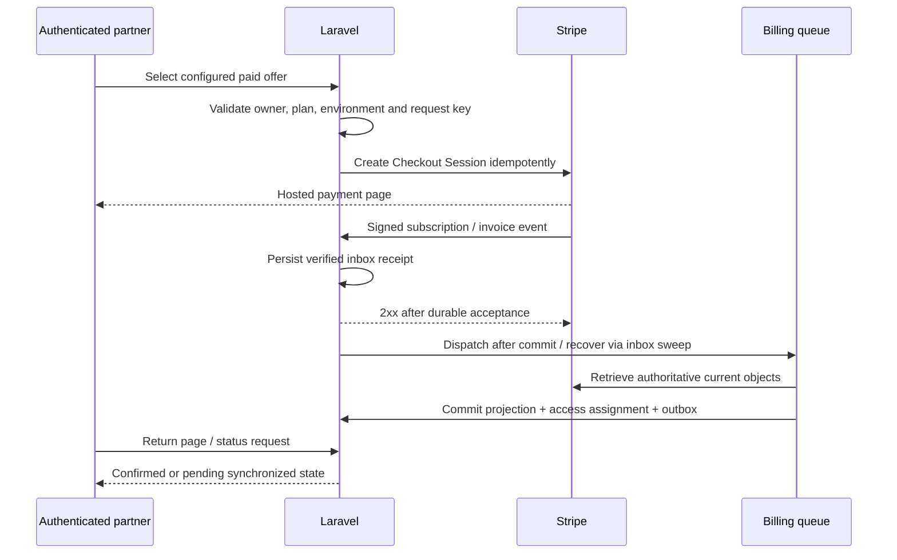

# Stripe Billing architecture

Status: proposed, not integrated. Read-only audit and official documentation check: 2026-10-20. No keys, Prices, Customers, webhooks or charges were created. Availability for the operator's Stripe account, region, currency and payment methods is unverified.

## Existing state and recommendation

`composer.json` requires Laravel 12 and PHP ^8.2; no Cashier or Stripe dependency exists in `composer.lock`. `User` has no Billable trait or Stripe fields. No subscriptions, billing events, checkout routes or billing policies exist. The current `active` account status is an administrative control and must not become a synonym for paid subscription.

**Recommendation: adopt Laravel Cashier Stripe behind a small application billing service in a later approved stage.** It fits the existing Laravel monolith and one billable user per workspace. Reuse its customer/subscription projection, Checkout and Portal support. Keep plan mapping, entitlements, durable event intake and administrative policy in the application. Cashier is not mandatory; direct `stripe-php` would reduce package conventions but require more custom subscription synchronization and tests, with no demonstrated need here.

Cashier's [Laravel 12 documentation](https://laravel.com/docs/12.x/billing) describes Billable model fields and `subscriptions`/`subscription_items`. The official [Cashier 16.x package constraints](https://github.com/laravel/cashier-stripe/blob/16.x/composer.json) include Laravel 12 and PHP compatible with this project. Exact package/SDK selection must be resolved and locked in a future dependency task; no package is installed by this architecture.

### Version and API contract

Record the exact Cashier release, `stripe/stripe-php` release, configured Stripe API version and webhook payload version in the future integration ADR and `composer.lock`. Do not rely on the moving `16.x` branch or an unqualified latest install as a frozen contract. The Laravel 12 billing guide documents Cashier 16 with `2025-06-30.basil`; current package constraints can admit newer SDK majors, so verify the actual selected SDK/API contract in sandbox before choosing a webhook version. Do not auto-select new preview APIs, thin events or Accounts v2 just because a current Stripe page recommends them for unrelated integrations. Use the documented snapshot Customer/Subscription integration supported by the chosen Cashier release unless an explicit compatibility decision changes it.

Use Cashier's authoritative local financial projection; **do not create a second `billing_subscriptions` table**. Use controlled plan/price mappings from [plans](07-plans-and-entitlements.md). External Stripe IDs need case-sensitive storage/collation; financial history must survive catalog archival. Access is derived separately and must not depend on a single mutable `users.plan` string.

## Proposed service responsibilities

| Component | Responsibility |
| --- | --- |
| `BillingService` | Authenticated command boundary; plan/price allowlist, customer ownership, idempotency and pending operations |
| Cashier + Stripe SDK | Provider requests and authoritative local subscription/item projection |
| Signed webhook intake | Authenticate raw request, validate environment/account, persist durable receipt, acknowledge |
| `SyncBillingEvent` | Retryable per-customer/subscription synchronization; no duplicate effects |
| `BillingAccessPolicy` | Translate synchronized financial state into an explicitly approved access policy |
| `EntitlementResolver` | Base plan plus valid overrides/limits, without granting admin permissions |
| Reconciler | Recover missed/stalled events and compare local projection with Stripe |

These names are proposed contracts, not existing classes. Stay in one Laravel application, one MySQL database per environment, existing database queues initially; no Redis/microservice requirement.

## Proposed customer journey

1. Public registration stays disabled until approved and the verification-flow defect is corrected. Onboarding should preserve the signed verification requirement.
2. Choosing Free creates a local entitlement assignment, without paid Checkout or a fabricated subscription.
3. For a paid offer, backend resolves the approved Stripe Price for the active environment; reject arbitrary `price_id`, amount, user/customer ID or return URL from the browser.
4. Find/create only the authenticated user's Stripe Customer. Protect duplicate customer creation with a durable operation key and owner serialization. Avoid holding a database row lock open during a network request; use pending-operation state plus idempotency/reconciliation.
5. Create Checkout with a stored operation UUID, configured success/cancel URLs and server-controlled reference metadata. Never put personal data or secrets in idempotency keys. Do not create another Session on an ambiguous timeout without reusing/reconciling the original operation.
6. Return page reports pending until authoritative synchronization. A successful redirect is not proof of payment; [Stripe requires webhook fulfillment](https://docs.stripe.com/checkout/fulfillment?payment-ui=stripe-hosted).
7. Portal creation derives the Customer from the current user and uses a configured return URL. No endpoint accepts another user's Customer ID. Portal capabilities and permitted products/prices are explicitly configured; see [official Portal integration](https://docs.stripe.com/customer-management/integrate-customer-portal).

## Events and status policy

Event selection must be reviewed against the chosen Cashier release. Its built-in webhook set includes events beyond the six application requirements. Do not subscribe only to the table below if that omits events needed to maintain Cashier's customer/payment-method projection. No duplicate stock Cashier and custom route may race to own the same projection.

| Event | Proposed application effect |
| --- | --- |
| `checkout.session.completed` | Bind/reconcile pending operation; no unconditional grant merely because the Session completed |
| `customer.subscription.created` | Retrieve and upsert actual subscription/items, resolve controlled price mapping |
| `customer.subscription.updated` | Reconcile status, period, item changes and scheduled cancellation |
| `customer.subscription.deleted` | Mark subscription ended; preserve history and customer records |
| `invoice.paid` | Synchronize invoice/payment evidence and subscription; settle any approved billing-triggered access transition once |
| `invoice.payment_failed` | Record/reconcile failure, initiate approved notification/recovery policy; never delete data |

Additional asynchronous Checkout payment, refund, dispute and payment-action events are selected only when the actual payment methods and business requirements need them. A refund does not automatically cancel a subscription or define an access policy. See [Stripe subscription webhook reference](https://docs.stripe.com/billing/subscriptions/webhooks).

Preserve provider status verbatim: `trialing`, `active`, `incomplete`, `incomplete_expired`, `past_due`, `unpaid`, `paused`, `canceled`. Do not compress all failures into `blocked`. `active` is not a guarantee that every invoice has been paid; [Stripe's subscription lifecycle](https://docs.stripe.com/billing/subscriptions/overview) distinguishes these states. Trials, grace windows, read-only access, scheduled cancellation timing and delinquency behavior remain operator decisions. Preserve leads/opportunities in every financial state. Keep account/billing recovery accessible except when a separate security suspension requires otherwise.

## Durable webhook intake and idempotency

Proposed `billing_events`: bigint ID; provider; account/environment; case-sensitive external event ID; object ID/type; event type; API version; received time; provider creation time for diagnostics only; processing state; attempt count; safe error code; next retry; processed time; protected minimal payload/reference under retention policy. UNIQUE(provider, account, environment, event_id). Do not store full card data or log raw events by default.

- Verify signature against raw bytes with the SDK and endpoint-specific secret before accepting a receipt. Retain timestamp tolerance and correct system clock. Reject unexpected `livemode` and account context. Signature checks do not replace durable replay deduplication.
- Commit receipt before returning 2xx. A duplicate receipt may receive 2xx only because its accepted durable work remains recoverable. On database failure return a retryable failure, never an acknowledgment that loses the event.
- Use after-commit dispatch plus an inbox sweeper so a crash between receipt commit and queue enqueue cannot strand work. An outbox row for downstream notifications/events is committed with the projection; dispatch and mark sent idempotently.
- Serialize projection updates by subscription/customer. Fetch provider state without holding database locks through HTTP; then apply with a claim/generation check and transaction. Reconcile again if a newer sync was requested during fetch. Avoid stale-snapshot overwrite.
- Duplicate event ID must not repeat domain effects. Different event IDs can describe the same object change, so downstream effects require their own business key (for example one invoice entitlement settlement), not only event deduplication.
- Event creation timestamps are not a reliable total order. Synchronize current objects and handle late deletion/termination safely; retain tombstone/end state and reconcile related resources rather than blindly replaying old snapshots.

[Stripe's webhook guidance](https://docs.stripe.com/webhooks) explicitly covers unordered and duplicate delivery, signatures and short acknowledgment paths. Outgoing API requests also need [Stripe idempotency keys](https://docs.stripe.com/api/idempotent_requests); database deduplication remains necessary after the provider retention window.

### Cashier integration seam to prove before adoption

Use one custom signed webhook entry point/inbox worker that delegates supported financial projection handling to the chosen Cashier version, or a tested extension of Cashier's controller with durable intake. Select the exact seam in the implementation spike; do not assume a listener added after Cashier processing makes the whole operation atomic. Pin the handler contract and test crash boundaries. Cashier's existing webhooks plus custom listeners must not double-process subscriptions or send duplicate notifications.

## Test/live and operations

Use a separate Stripe sandbox, test keys, webhook secret and database/config for integration tests; live keys/resources never enter local tests. Stripe documents independent [API keys and sandbox/live contexts](https://docs.stripe.com/keys). Resolve mode at deployment, reject mode mismatches at startup/ingress, keep secrets in protected configuration outside Git, and never print resolved secret-bearing config. No real payment card data is stored locally.

Cashier's normal billable user stores one Stripe customer identifier. Therefore do not point sandbox and live billing at the same users/subscriptions database and alternate keys; that could bind a live user to a sandbox-only Customer. Environment fields on event/catalog mappings supplement separate environments and do not make a shared Cashier customer projection safe by themselves.

Periodic reconciliation is a proposed dedicated scheduler task, with cursor/batches/backoff, no full-account polling per request. Prioritize failed/pending events and stale subscriptions. Track event lag, retries, dead letters, signature failure count and reconciliation drift without logging sensitive payloads. Keep billing work separate from browser scraping so browser pressure cannot indefinitely postpone entitlement synchronization. No existing CRM/n8n/Evolution service is reused.

## Tests and go-live gates

Sandbox tests: Free path, unknown/unmapped/inactive Price, Customer ownership, repeated Checkout, ambiguous create response, valid/invalid/stale signature, wrong mode, duplicate event, distinct equivalent events, reversed order, crash before/after inbox commit, enqueue failure, crash during projection/outbox, subscription changes/cancellation, failed/late payment, supported asynchronous methods, reconciliation, portal ownership and admin exceptions. MySQL tests must validate unique keys/transactions with independent processes. Fake tests alone cannot certify webhook network delivery.

Before live activation require: actual Stripe account/country/method availability; approved prices/terms/access policies; locked dependency/API versions; reviewed additive migrations; secure HTTPS endpoint; valid signing secret; operational billing worker/scheduler plan; recovery/alerts; sandbox evidence and explicit operator authorization. This document authorizes none of those operations.
